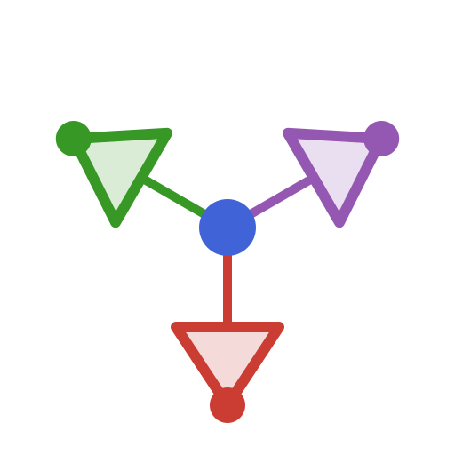
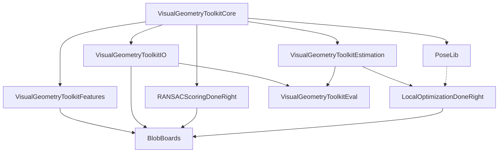

<p align="center"></p>

# VisualGeometryToolkit.jl

by [James Pritts](https://prittjam.github.io/)

Composable Julia packages for robust multiple-view geometry: geometric types,
file formats, feature detection, robust estimation and RANSAC, calibration
(camera and lens models, hand–eye), fiducial markers (BlobBoards), evaluation
protocols, and a PoseLib wrapper, factored so each layer is usable on its own.

This repository is a Julia workspace. Each directory below is a separately
registered package with its own version, tests and documentation.

| Package | Role | Docs |
|---|---|---|
| [VisualGeometryToolkitCore](VisualGeometryToolkitCore) | Geometric types, frames, camera and lens models, minimal solvers, scale-space kernels, the robust-estimation contracts | [docs](https://visualgeometrytoolkit.github.io/VisualGeometryToolkitCore/) |
| [VisualGeometryToolkitIO](VisualGeometryToolkitIO) | Versioned file formats: cameras, rigs, observations, targets, correspondences | [docs](https://visualgeometrytoolkit.github.io/VisualGeometryToolkitIO/) |
| [VisualGeometryToolkitFeatures](VisualGeometryToolkitFeatures) | Feature detection (ASIFT/DoG with keypoint covariance) and matching | [docs](https://visualgeometrytoolkit.github.io/VisualGeometryToolkitFeatures/) |
| [VisualGeometryToolkitEstimation](VisualGeometryToolkitEstimation) | The RANSAC loop, problem implementations, IRLS, hand–eye calibration | [docs](https://visualgeometrytoolkit.github.io/VisualGeometryToolkitEstimation/) |
| [VisualGeometryToolkitEval](VisualGeometryToolkitEval) | Evaluation protocol, benchmark pools, tuning, reproducible paper projects | [docs](https://visualgeometrytoolkit.github.io/VisualGeometryToolkitEval/) |
| [PoseLib](PoseLib) | Julia wrapper of the PoseLib minimal solvers (prebuilt binaries as package artifacts) | [docs](https://visualgeometrytoolkit.github.io/PoseLib/) |

Related packages in their own repositories:
[RANSACScoringDoneRight.jl](https://github.com/VisualGeometryToolkit/RANSACScoringDoneRight.jl)
(scale-free marginal RANSAC scoring),
[LocalOptimizationDoneRight.jl](https://github.com/VisualGeometryToolkit/LocalOptimizationDoneRight.jl)
(local optimization for RANSAC) and
[BlobBoards.jl](https://github.com/VisualGeometryToolkit/BlobBoards.jl)
(fiducial blob-board targets). All documentation is aggregated at
<https://visualgeometrytoolkit.github.io>.

## Package stack



Each package builds on the ones above it (direct dependencies; edges implied through another package are omitted). Dashed: optional (package extension).

## Installation

Every package is registered in [CauRegistry](https://github.com/prittjam/CauRegistry.jl)
and submitted to the General registry. Until it is in General, add both
registries once per depot (General first: Pkg adds it on its own only to an
empty depot), then add packages as usual:

```julia
using Pkg
Pkg.Registry.add("General")
Pkg.Registry.add(url = "https://github.com/prittjam/CauRegistry.jl")
Pkg.add("VisualGeometryToolkitEstimation")      # pulls VisualGeometryToolkitCore
```

Manifests record each package by UUID, version and tree hash, never by
registry, so an environment resolves the same from either registry.

**Recovering the full speed of the LM driver.** The stack's Levenberg–Marquardt driver is NLLSsolver. Until the upstream release that contains our pull requests ([#60](https://github.com/ojwoodford/NLLSsolver.jl/pull/60) Schur complement, [#61](https://github.com/ojwoodford/NLLSsolver.jl/pull/61), [#62](https://github.com/ojwoodford/NLLSsolver.jl/pull/62), [#63](https://github.com/ojwoodford/NLLSsolver.jl/pull/63)), a registry install resolves the published NLLSsolver, on which everything is correct but the relative-pose bundle runs about 2× slower and local-optimisation refits about 1.2× slower than with our fork. A checkout of this repository already pins the fork through `[sources]`. For an environment built from the registry, pin it yourself, once, in that environment:

```julia
using Pkg
Pkg.add(PackageSpec(url = "https://github.com/prittjam/NLLSsolver.jl", rev = "stack"))
```

`stack` is the latest upstream release plus the unmerged pull requests, rebased onto each new release. Verify with `using NLLSsolver; isdefined(NLLSsolver, :MultiVariateLSschur)` → `true`. For a run that feeds a figure, replace `rev = "stack"` by the commit sha so every machine resolves the same tree. When the upstream release lands, `Pkg.free("NLLSsolver")` returns the environment to the registry and this note is removed.

## Development

```bash
git clone https://github.com/VisualGeometryToolkit/VisualGeometryToolkit.jl
cd VisualGeometryToolkit.jl
git config core.hooksPath .githooks
julia --project=. -e 'using Pkg; Pkg.instantiate()'
julia --project=VisualGeometryToolkitCore -e 'using Pkg; Pkg.test()'
```

Inside the workspace every stack package resolves to its directory here, so a
change to VisualGeometryToolkitCore is seen by the packages that depend on it. See
[CLAUDE.md](CLAUDE.md) for the conventions and [RELEASING.md](RELEASING.md)
for registration.

## Citing

Cite the toolkit; [CITATION.cff](CITATION.cff) is the source of this entry
(GitHub's "Cite this repository" button exports it):

```bibtex
@software{pritts2026vgtk,
  author = {Pritts, James and Sauer, Hendrik},
  title  = {{VisualGeometryToolkit.jl}: Julia Packages for Multiple-View Geometry},
  url    = {https://github.com/VisualGeometryToolkit/VisualGeometryToolkit.jl},
  year   = {2026}
}
```

Cite also the papers behind the methods you use, listed on
[the portal](https://visualgeometrytoolkit.github.io/#publications).

## License

MIT, James Pritts; PoseLib, MIT, Kiel University (each package directory
carries its own copy). See
[AUTHORS.md](AUTHORS.md).

Maintainer: [James Pritts](https://prittjam.github.io/).
