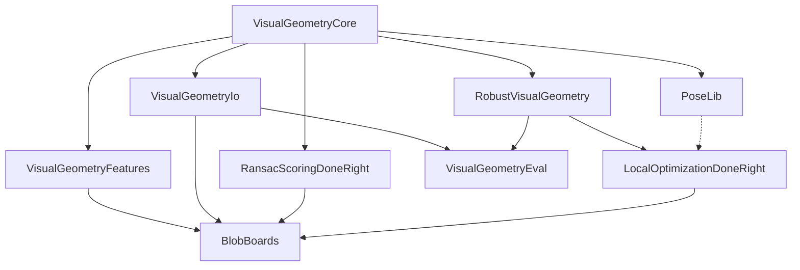

<p align="center"></p>

# VisualGeometryToolkit.jl

by [James Pritts](https://prittjam.github.io/)

Composable Julia packages for robust multiple-view geometry: geometric types,
file formats, feature detection, robust estimation and RANSAC, calibration
(camera and lens models, hand–eye), fiducial markers (BlobBoards), evaluation
protocols, and a PoseLib wrapper, factored so each layer is usable on its own.

This repository is a Julia workspace. Each directory below is a separately
registered package with its own version, tests and documentation.

| Package | Role | Docs |
|---|---|---|
| [VisualGeometryCore](VisualGeometryCore) | Geometric types, frames, camera and lens models, minimal solvers, scale-space kernels, the robust-estimation contracts | [docs](https://visualgeometrytoolkit.github.io/VisualGeometryCore/) |
| [VisualGeometryIo](VisualGeometryIo) | Versioned file formats: cameras, rigs, observations, targets, correspondences | [docs](https://visualgeometrytoolkit.github.io/VisualGeometryIo/) |
| [VisualGeometryFeatures](VisualGeometryFeatures) | Feature detection (ASIFT/DoG with keypoint covariance) and matching | [docs](https://visualgeometrytoolkit.github.io/VisualGeometryFeatures/) |
| [RobustVisualGeometry](RobustVisualGeometry) | The RANSAC loop, problem implementations, IRLS, hand–eye calibration | [docs](https://visualgeometrytoolkit.github.io/RobustVisualGeometry/) |
| [VisualGeometryEval](VisualGeometryEval) | Evaluation protocol, benchmark pools, tuning, reproducible paper projects | [docs](https://visualgeometrytoolkit.github.io/VisualGeometryEval/) |
| [PoseLib](PoseLib) | Julia wrapper of the PoseLib minimal solvers (prebuilt binaries as package artifacts) | [docs](https://visualgeometrytoolkit.github.io/PoseLib/) |

Related packages in their own repositories:
[RansacScoringDoneRight.jl](https://github.com/VisualGeometryToolkit/RansacScoringDoneRight.jl)
(scale-free marginal RANSAC scoring),
[LocalOptimizationDoneRight.jl](https://github.com/VisualGeometryToolkit/LocalOptimizationDoneRight.jl)
(local optimization for RANSAC) and
[BlobBoards.jl](https://github.com/VisualGeometryToolkit/BlobBoards.jl)
(fiducial blob-board targets). All documentation is aggregated at
<https://visualgeometrytoolkit.github.io>.

## Package stack



Each package builds on the ones above it (direct dependencies; edges implied through another package are omitted). Dashed: optional (package extension).

## Installation

Every package is registered in [CauRegistry](https://github.com/prittjam/CauRegistry.jl)
and submitted to the General registry. Until it is in General, add both
registries once per depot (General first: Pkg adds it on its own only to an
empty depot), then add packages as usual:

```julia
using Pkg
Pkg.Registry.add("General")
Pkg.Registry.add(url = "https://github.com/prittjam/CauRegistry.jl")
Pkg.add("RobustVisualGeometry")      # pulls VisualGeometryCore
```

Manifests record each package by UUID, version and tree hash, never by
registry, so an environment resolves the same from either registry.

## Development

```bash
git clone https://github.com/VisualGeometryToolkit/VisualGeometryToolkit.jl
cd VisualGeometryToolkit.jl
git config core.hooksPath .githooks
julia --project=. -e 'using Pkg; Pkg.instantiate()'
julia --project=VisualGeometryCore -e 'using Pkg; Pkg.test()'
```

Inside the workspace every stack package resolves to its directory here, so a
change to VisualGeometryCore is seen by the packages that depend on it. See
[CLAUDE.md](CLAUDE.md) for the conventions and [RELEASING.md](RELEASING.md)
for registration.

## License

MIT, Kiel University (each package directory carries its own copy). See
[AUTHORS.md](AUTHORS.md).

Maintainer: [James Pritts](https://prittjam.github.io/).
